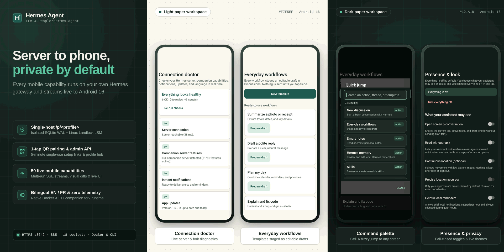

<!-- Generated by scripts/docs_fork.py from docs/sources/MOBILE_COMPANION.md.in and docs/sources/fork_facts.json. Do not edit directly. -->

# Hermes Mobile companion guide

<p align="center">
  
</p>

This guide walks you through running **`LLM-4-People/hermes-agent`** as the private backend for **[Hermes Mobile](https://llm-4-people.github.io/hermes-mobile/)** without deep infrastructure or AI jargon.

<p align="center">
  <a href="https://llm-4-people.github.io/hermes-mobile/en/walkthrough/"></a>
</p>

---

## 1. Why use the companion fork?

Hermes Mobile can connect to any Hermes API server, but `LLM-4-People/hermes-agent` provides the full native Android companion surface out of the box:

- **Live widgets and custom screens** (`mobile_ui`) that Hermes can draft, preview, apply, and revert cleanly.
- **Phone deliveries and briefings** (`mobile_deliver`) that land in your Activity feed without interrupting your current chat.
- **Approved Android device actions** (`mobile_device` / `request_device_action`) across 29 capabilities (20 core OS actions plus 9 deep Android 16 bidirectional actions), always behind an explicit on-phone approval sheet.
- **Brain, memory, smart notes, skill studio, universal sharing, and habits** with full REST APIs, keyset cursor pagination, and FTS5 cross-session search.
- **Single-host multi-user profiles (`/p/<profile>`)** so one small server can privately serve your family or team (up to 32 concurrent runs globally, 12 per profile by default).
- **Small-LLM friendly and bilingual (`en`/`fr`)** companion instructions that work reliably even on fast, lightweight models.

---

## 2. 3-minute Docker Compose setup

### Step 1 — Create your data directory and API key

Choose a persistent host folder (for example `~/.hermes` or `/srv/hermes`) and generate a long, random bearer key:

```bash
mkdir -p ~/.hermes
python3 -c 'import secrets; print("API_SERVER_KEY=" + secrets.token_urlsafe(32))' >> ~/.hermes/.env
cat >> ~/.hermes/.env <<'EOF'
API_SERVER_ENABLED=true
API_SERVER_HOST=0.0.0.0
API_SERVER_PORT=8642
EOF
chmod 600 ~/.hermes/.env
```

> **Tip:** Never reuse a short password or placeholder like `change-me`. Use at least 24 random characters and keep `.env` readable only by your host user (`chmod 600`).

### Step 2 — Create `docker-compose.yml`

```yaml
services:
  hermes:
    # For production, pin a specific @sha256 digest from GHCR
    image: ghcr.io/llm-4-people/hermes-agent:edge
    container_name: hermes
    restart: unless-stopped
    ports:
      # Keep bound to localhost and terminate HTTPS in Caddy, Nginx, or Tailscale Serve
      - "127.0.0.1:8642:8642"
    environment:
      HERMES_UID: "${HERMES_UID:-1000}"
      HERMES_GID: "${HERMES_GID:-1000}"
    volumes:
      - ~/.hermes:/opt/data
    command: ["gateway", "run"]
```

Start Hermes and select your LLM provider/model:

```bash
HERMES_UID="$(id -u)" HERMES_GID="$(id -g)" docker compose up -d
docker exec -it hermes hermes model
```

> **Verify container provenance (optional):** Every image published to `ghcr.io/llm-4-people/hermes-agent` is signed with keyless Cosign and includes BuildKit provenance and an SPDX SBOM. See [DOWNSTREAM.md](../DOWNSTREAM.md#image) for the exact `cosign verify` command.

### Step 3 — Put HTTPS in front of port `8642`

Hermes Mobile expects HTTPS when connecting outside your home LAN. Keep port `8642` bound to `127.0.0.1` and expose it through a reverse proxy (Caddy, Nginx, Traefik, or Tailscale Serve) with **streaming/SSE buffering disabled**:

- **Caddy** handles Server-Sent Events (SSE) streaming automatically:
  ```caddyfile
  hermes.example.com {
      reverse_proxy 127.0.0.1:8642
  }
  ```
- **Nginx** needs proxy buffering turned off so live replies stream word-by-word:
  ```nginx
  location / {
      proxy_pass http://127.0.0.1:8642;
      proxy_http_version 1.1;
      proxy_set_header Host $host;
      proxy_set_header Connection "";
      proxy_buffering off;
      proxy_cache off;
      proxy_read_timeout 3600s;
  }
  ```

### Step 4 — Run the built-in self-check (`scripts/mobile_doctor.py`)

Before touching your phone, verify the server in one command (uses Python's standard library only — zero extra packages, and never prints secrets):

```bash
python3 scripts/mobile_doctor.py \
  --hermes-home ~/.hermes \
  --public-url https://hermes.example.com
```

Or run it directly inside the container:

```bash
docker exec hermes python3 /opt/hermes/scripts/mobile_doctor.py \
  --hermes-home /opt/data \
  --public-url https://hermes.example.com
```

When everything is green, `mobile_doctor.py` prints the exact copy-paste URL for each active profile.

---

## 3. Single-host multi-user setup (`/p/<profile>`)

You do **not** need one Docker container per person. One gateway process can safely serve multiple isolated users under `/p/<profile>`:

1. **Enable profile multiplexing** in `~/.hermes/config.yaml`:
   ```yaml
   gateway:
     multiplex_profiles: true
   ```
2. **Create a profile for each user**:
   ```bash
   docker exec -it hermes hermes profile create alice
   ```
3. **Give that profile its own unique API key** in `~/.hermes/profiles/alice/.env`:
   ```bash
   python3 -c 'import secrets; print("API_SERVER_KEY=" + secrets.token_urlsafe(32))' >> ~/.hermes/profiles/alice/.env
   echo "API_SERVER_ENABLED=true" >> ~/.hermes/profiles/alice/.env
   chmod 600 ~/.hermes/profiles/alice/.env
   ```
4. **Verify every profile** with `mobile_doctor.py`:
   ```bash
   python3 scripts/mobile_doctor.py \
     --hermes-home ~/.hermes \
     --public-url https://hermes.example.com
   ```

Each person connects Hermes Mobile to their own URL and their own key:

| Profile | Connection URL in Hermes Mobile | Key source |
|---|---|---|
| Default (`default`) | `https://hermes.example.com` | `~/.hermes/.env` (`API_SERVER_KEY`) |
| Secondary (`alice`) | `https://hermes.example.com/p/alice` | `~/.hermes/profiles/alice/.env` (`API_SERVER_KEY`) |
| Secondary (`bob`) | `https://hermes.example.com/p/bob` | `~/.hermes/profiles/bob/.env` (`API_SERVER_KEY`) |

**What stays strictly isolated per profile:**
- Bearer authentication (`401` if a key does not match that profile; `404` for unknown or unserved `/p/<name>` prefixes).
- Conversations, SQLite transcript databases, search indexes, and uploaded files.
- Memory, smart notes, skills, habits, live UI widgets/surfaces, and phone deliveries.
- Workspace files, per-profile concurrency quotas (`12` concurrent runs per profile, `32` globally), and model/language defaults.
- When two users on the same server *want* to share a note, thread, or artifact, they can opt in explicitly through **Shared with me** (`/api/shares`), with instant revocation at any time.

---

## 4. Connecting the Hermes Mobile Android app

1. Install the latest signed APK from **[Hermes Mobile](https://llm-4-people.github.io/hermes-mobile/)**.
2. Open the app and create your local profile lock (passphrase plus optional biometrics).
3. Enter:
   - **Server URL:** the exact URL printed by `mobile_doctor.py` (for example `https://hermes.example.com` or `https://hermes.example.com/p/alice`).
   - **API key:** that profile's `API_SERVER_KEY`.
4. Open **Activity -> Connection doctor** inside the app to confirm green checks for reachability, companion capabilities (`59/59`), toolsets, and language sync.

---

## 5. Full companion surface: 59 capabilities and 18 default toolsets

`GET /v1/capabilities` advertises **59 active companion capabilities** (57 enabled feature flags plus the 2 session-continuity headers `X-Hermes-Session-Id` and `X-Hermes-Session-Key`) across **84 authenticated endpoints**:

| Area | Active `/v1/capabilities` flags |
|---|---|
| **Conversations and streaming** | `chat_completions`, `chat_completions_streaming`, `responses_api`, `responses_streaming`, `session_resources`, `session_chat`, `session_chat_streaming`, `session_fork`, `session_model_lock`, `session_continuity_header`, `session_key_header`, `session_search`, `session_fork_at_turn`, `session_export`, `session_uploads` |
| **Live runs, steering, and safety** | `run_submission`, `runs_idempotency`, `run_status`, `run_events_sse`, `run_stop`, `run_steer`, `run_approval_response`, `tool_progress_events`, `approval_events`, `reasoning_streaming`, `run_toolset_selection`, `run_tool_exclusions`, `run_scoped_instructions`, `structured_approval_diffs`, `run_progress_hooks`, `run_unknown_resolution`, `run_clarify_response` |
| **Coding, models, and workspace** | `model_options`, `run_metrics_v2`, `live_coding_stream`, `model_capability_metadata`, `workspace_browser`, `usage_analytics`, `cron_run_history` |
| **Brain, notes, sharing, and skills** | `memory_write_api`, `skills_api`, `memory_api`, `skill_studio`, `profile_defaults`, `smart_notes`, `note_sharing`, `universal_sharing`, `habit_suggestions` |
| **Native Android companion and bilingual** | `live_ui_modding`, `mobile_deliveries`, `device_bridge`, `app_presence_v2`, `interactive_cards`, `deep_android_bridge`, `cursor_pagination`, `bilingual_i18n`, `frictionless_onboarding`, `profile_management`, `admin_settings` |

*(5 admin or legacy flags remain deliberately disabled on the public API surface by default: `admin_config_rw`, `jobs_admin`, `audio_api`, `realtime_voice`, and `cors` unless explicitly configured.)*

### 18 default enabled toolsets (of 29 built-in configurable toolsets in `hermes_cli/tools_config.py`)

| Category | Enabled by default |
|---|---|
| **Mobile companion (4)** | `mobile_ui` (`mobile_ui_patch`), `mobile_deliver` (`mobile_deliver`), `mobile_device` (`request_device_action`), `mobile_profiles` (`manage_profiles`) |
| **Web and research (2)** | `web` (`web_search`, `web_extract`), `browser` (`browser_*`) |
| **Coding and files (3)** | `file` (`read_file`, `write_file`, `patch`, `search_files`), `terminal` (`terminal`, `process_manage`), `code_execution` (`execute_code`) |
| **Media and creativity (2)** | `vision` (`vision_analyze`), `image_gen` (`image_generate`) |
| **Memory, knowledge, and planning (5)** | `memory` (`memory`, `mobile_notes`, `mobile_share`), `session_search`, `skills` (`skills_list`, `skill_view`, `skill_manage`), `todo`, `cronjob` |
| **Delegation and integrations (2)** | `delegation` (`delegate_task`), `connections` (`manage_connections`) |

Optional opt-in built-in toolsets (disabled by default until configured; 11 total, plus optional plugin toolsets such as `a2a`): `video`, `video_gen`, `x_search`, `tts`, `stt`, `kanban`, `context_engine`, `clarify`, `discord`, `discord_admin`, `computer_use`.

### 29 approved Android device bridge capabilities

When the Android app includes `device_capabilities` on a `/v1/runs` request, Hermes may request any advertised action through `request_device_action`, pausing the run until the user taps **Allow** or **Deny** on their phone (20 core OS capabilities plus 9 deep Android 16 actions):

- **Capture and location:** `camera`, `location_coarse`, `nearby_osm`
- **Maps and navigation:** `maps_handoff`, `map_navigation`
- **Time and calendar:** `alarm_timer`, `calendar_draft`, `calendar_read`
- **Communication drafts (never auto-sent):** `dial_draft`, `sms_draft`, `email_draft`, `contacts_pick`, `contact_draft`, `share_sheet`
- **Clipboard and media:** `clipboard_read`, `clipboard_write`, `media_control`
- **Ambient notifications (opt-in):** `notifications_digest`, `notification_reply`
- **Live UI surfaces:** `ui_surfaces_v2`
- **Deep Android 16 app control and actions (9):** `android_open_app`, `android_proactive_nudge`, `android_set_timer`, `android_share_sheet`, `android_sync_shortcuts`, `app_create_template`, `app_customize`, `app_navigate`, `app_read_state`

---

## 6. Small-LLM ergonomics and bilingual (`en`/`fr`) support

You do not need a frontier-priced model to get a great mobile experience:

- **Focused per-run mobile prompt (`agent/mobile_companion_prompt.py`)**: On mobile-originated runs, Hermes automatically injects a short, capability-filtered instruction block via `run_instruction_scope`. Non-mobile runs, background jobs, and resumed Codex threads never see it.
- **Forgiving tool inputs**: Friendly aliases (such as `timer` -> `alarm_timer`, `music` -> `media_control`, `agenda` -> `calendar_read`, `photo` -> `camera`) are normalized automatically. `mobile_ui_patch` auto-generates widget IDs from titles and ships WCAG 2.1 AA accent presets (`teal`, `green`, `blue`, `amber`, `coral`).
- **Automatic bilingual alignment**: Set your profile default `preferred_language` (`auto`, `fr`, or `en`) in the app, or let per-run `user_language` / `X-Hermes-Lang` / `Accept-Language` align responses automatically (`gateway/i18n.py` plus 17 locale catalogs in `locales/`).

---

## 7. Security and privacy boundaries

Hermes Mobile and this fork are designed **fail-closed by default**:

1. **Mandatory bearer auth:** Every private endpoint requires the profile's `API_SERVER_KEY` (constant-time verification). Never expose port `8642` directly on the public internet without HTTPS.
2. **Dynamic tool exposure:** `request_device_action` is dynamically attached **only** for the duration of a `/v1/runs` turn that explicitly advertises `device_capabilities`, and immediately detached afterwards.
3. **Explicit on-phone approval:** Every device action and destructive terminal/file action requires explicit human confirmation. Communication actions (`sms_draft`, `email_draft`, `dial_draft`, `calendar_draft`) open editable drafts and never send silently.
4. **Zero-leak widgets and HTTP responses:** Mobile UI endpoints send `Cache-Control: no-store`, and secret-pattern scanning blocks credentials or tokens from being written into live UI patches or home-screen widgets.
5. **Strict per-profile isolation:** Profiles never share memory, notes, transcript rows, or bearer credentials unless explicitly shared via `/api/shares`.

---

## 8. Troubleshooting

| Symptom | Likely cause | Fix |
|---|---|---|
| **`401 Unauthorized`** in app or `mobile_doctor.py` | Missing or mismatched `API_SERVER_KEY` (especially on `/p/<profile>`) | Check the exact profile's `.env` file (`~/.hermes/.env` or `~/.hermes/profiles/<name>/.env`) and restart `hermes` after editing `.env`. |
| **`404 Unknown or unconfigured profile`** | `gateway.multiplex_profiles: true` is off, or profile name does not exist | Enable `gateway.multiplex_profiles: true` in `~/.hermes/config.yaml`, run `hermes profile create <name>`, and restart the gateway. |
| **Replies arrive all at once instead of streaming** | Reverse proxy is buffering Server-Sent Events | Disable proxy buffering (`proxy_buffering off;` in Nginx; see Step 3 above). |
| **Connection doctor warns about missing companion capabilities** | Running stock upstream `NousResearch/hermes-agent` instead of this fork | Switch your container image to `ghcr.io/llm-4-people/hermes-agent:edge` (or a pinned `@sha256` digest from this fork) and recreate the container. |
| **Model errors on first message** | No LLM provider/API key configured yet | Run `docker exec -it hermes hermes model` to configure your provider and pick a default model. |
| **Need a safe diagnostic summary to share** | Want to check setup without leaking secrets | Run `python3 scripts/mobile_doctor.py --json` — all secrets are strictly redacted. |
